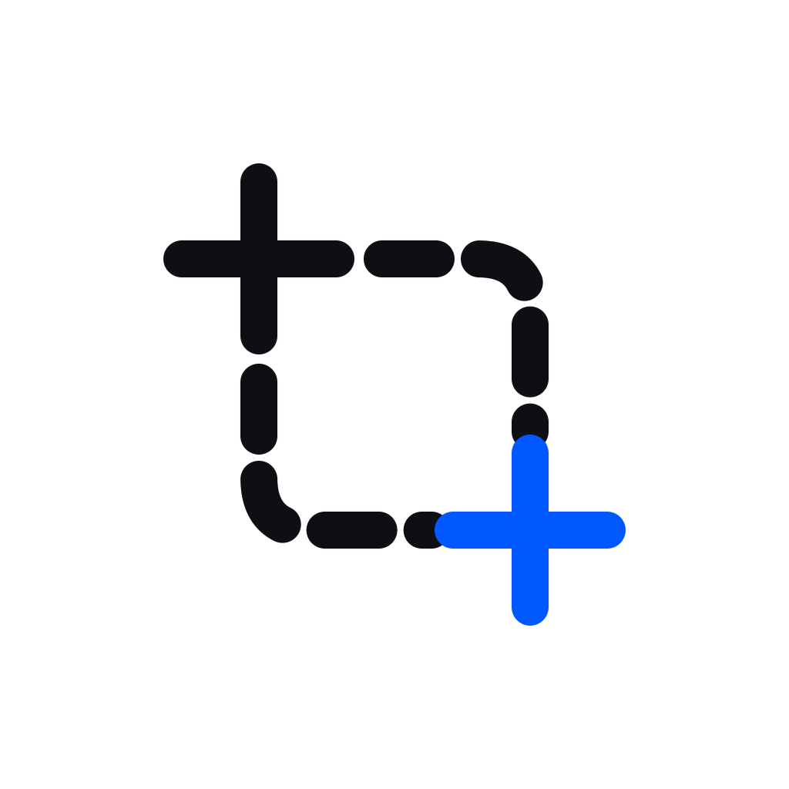
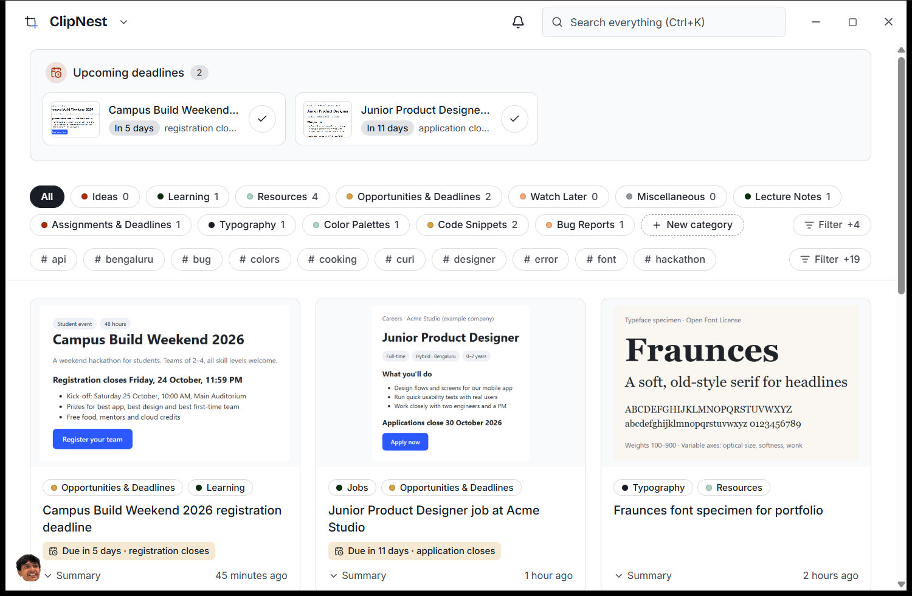
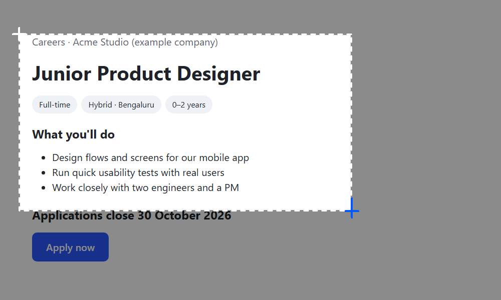
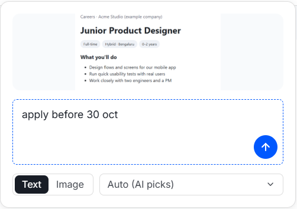
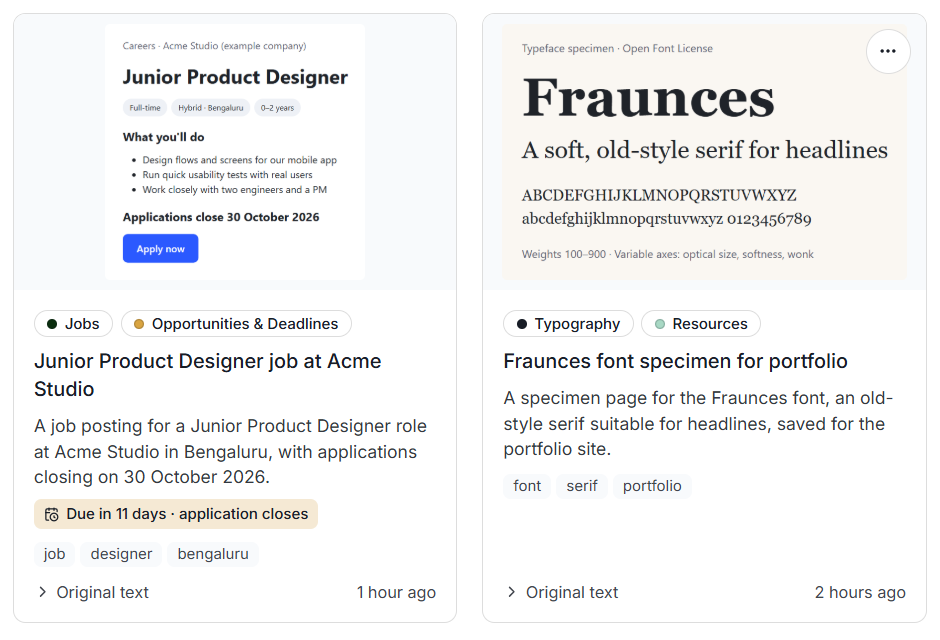
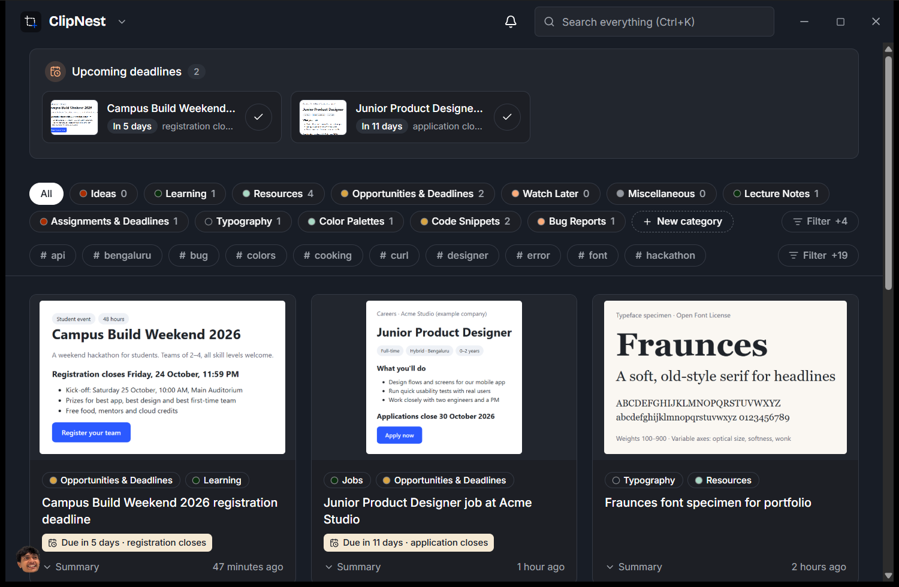
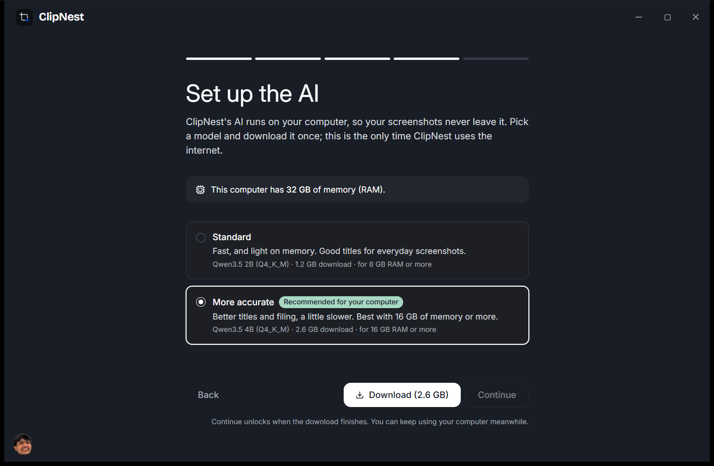
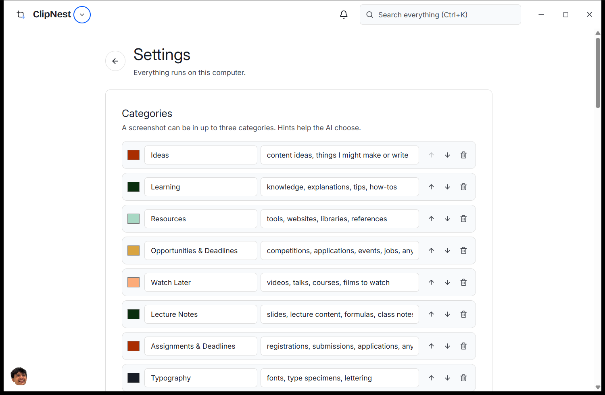
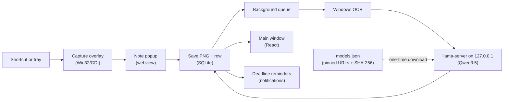

<p align="center">
  
</p>

<h1 align="center">ClipNest</h1>

<p align="center">
  <strong>Save anything on your screen in a second. Find it again when you need it.</strong><br>
  A local-first screenshot organizer for Windows, with a small AI that runs on your own computer.<br>
  <sub>ClipNest by <a href="https://github.com/reportedguy">reportedguy</a></sub>
</p>

<p align="center">
  <a href="LICENSE"></a>
  <a href="https://github.com/reportedguy/clipnest/releases/latest"></a>
  <a href="https://github.com/reportedguy/clipnest/actions/workflows/ci.yml"></a>
  
  <a href="CONTRIBUTING.md"></a>
</p>



## What is ClipNest?

You take screenshots to remember things: a deadline in a chat, a font on a website, a slide from a lecture, a receipt. They pile up in a folder with names like `Screenshot 2026-10-14 093112.png`, and you never find them again.

ClipNest is a snipping tool that also files what you capture. Press a shortcut, drag around what you want, type a short note, press Enter. A small AI model running on your computer reads the screenshot and your note, gives it a title and summary, puts it in the right categories, and turns dates in your note into reminders. Nothing is uploaded: there's no account, no cloud and no telemetry.

It's for anyone who screenshots to remember: students, designers, developers, marketers, founders, writers. It's built for ordinary laptops (8 GB of memory, no graphics card needed).

## Features

**Capture**
- Global shortcut (**Win+Shift+J** by default; falls back to Ctrl+Shift+J if another app owns it; any shortcut can be set in Settings). Also from the tray icon's "Capture now".
- Native overlay that freezes and dims every monitor, so menus and tooltips stay put while you drag.
- A small note box after each capture. Choose "Text" (read the words) or "Image" (look at the picture), and let the AI pick categories or pick them yourself.

**Organized for you**
- Text recognition with the OCR engine built into Windows.
- A local AI ([llama.cpp](https://github.com/ggml-org/llama.cpp) running a Qwen3.5 model) writes a title, a summary and tags, and files each screenshot into up to three categories. Screenshots with almost no text switch to image mode automatically (this uses the optional image add-on).
- Starter categories for your profession (student, developer, designer, marketer and more), which you can rename, recolor, reorder, hint and extend.
- Two model sizes, recommended from your computer's memory: Standard (1.2 GB download, fine on 8 GB) and More accurate (2.6 GB, for 16 GB or more). An optional image add-on (about 0.7 GB) lets the AI understand pictures.

**Find it again**
- Full-text search across titles, summaries, notes, recognized text and tags (Ctrl+K).
- Filter by category and tag. Tags follow the categories you've selected, and libraries with dozens of categories and thousands of tags stay fast.
- Cards show the screenshot, categories and title; click a card for its summary, tags, your note and any links.

**Deadlines**
- When your note says you want to act ("apply by Friday", "remind me", "register before…"), the date becomes a reminder.
- Upcoming deadlines on the home screen, a reminders bell, and a Windows notification at the time you choose.

**Yours to keep**
- Everything is stored on your computer in a local database plus the original PNG files.
- A daily database backup (the last 3 are kept), with automatic recovery if the database is ever damaged.
- "Export all data" writes one zip with every original screenshot plus an index in JSON and Markdown.
- Light and dark themes, starts with Windows, lives in the tray, and the AI can pause on battery saver.

## Screenshots

| | |
| --- | --- |
|  |  |
|  |  |
|  |  |

## Install

ClipNest runs on **Windows 10 and 11, 64-bit (Intel or AMD)** with 8 GB of memory or more. You need about 2 to 4 GB of free disk space, mostly for the AI model, and internet once to download it.

1. Download `ClipNest_<version>_x64-setup.exe` from the [latest release](https://github.com/reportedguy/clipnest/releases/latest).
2. Optional: check the download. In PowerShell, run `Get-FileHash .\ClipNest_<version>_x64-setup.exe -Algorithm SHA256` and compare the result with `SHA256SUMS.txt` on the release page.
3. Double-click the installer. It installs for your user only and needs no admin rights. On Windows 10 it downloads the WebView2 runtime if it's missing.

**"Windows protected your PC"**: ClipNest isn't code-signed yet, so Windows SmartScreen warns about any new download it hasn't seen before. If you downloaded the installer from this repository's Releases page (and, ideally, the checksum matches), click **More info**, then **Run anyway**. Never run a ClipNest installer from anywhere else.

macOS and Linux aren't supported yet; see the [roadmap](ROADMAP.md).

## How to use

1. **First run.** Pick what you do (this sets your starter categories), check the list, then set up the AI: ClipNest shows how much memory your computer has and recommends a model. Click Download. The next step unlocks when it's ready.
2. **Capture.** Press **Win+Shift+J** anywhere, drag around what you want, type a note like "apply by Friday" or "font for the website", and press **Enter**. Esc cancels.
3. **Let it file.** The screenshot is saved immediately. A few seconds later (longer on slower laptops) it has a title, categories and tags.
4. **Find it.** Open ClipNest from the tray. Filter with the category and tag pills, use **Filter** to search pills that didn't fit, or press **Ctrl+K** to search everything.
5. **Act on deadlines.** Reminders appear at the top of the home screen and under the bell. Tick one when it's done.
6. **Fix anything.** Each card's **…** menu edits categories, title and summary, the note or the deadline, copies or opens the image, retries the AI, or deletes (with undo).

Closing the window keeps ClipNest in the tray so the shortcut keeps working. Right-click the tray icon and choose **Quit** to exit.

## Build from source

Prerequisites (Windows 10/11):

- [Rust](https://rustup.rs), stable MSVC toolchain (developed with 1.99)
- [Visual Studio 2022 Build Tools](https://visualstudio.microsoft.com/visual-cpp-build-tools/) with the "Desktop development with C++" workload and a Windows SDK
- [Node.js](https://nodejs.org) 22 or newer and [pnpm](https://pnpm.io) 11
- WebView2 runtime (preinstalled on Windows 11)

```bash
git clone https://github.com/reportedguy/clipnest.git
cd clipnest
pnpm install
pnpm tauri dev        # run with hot reload
```

```bash
pnpm lint             # oxlint
pnpm format:check     # Prettier
pnpm typecheck        # TypeScript
pnpm test             # UI unit tests (Vitest)
cd src-tauri
cargo fmt --check
cargo clippy --all-targets -- -D warnings
cargo test            # Rust unit tests
```

```bash
pnpm tauri build      # installer in src-tauri/target/release/bundle/nsis/
```

To try the app without touching your own library, give the dev build its own data folder:

```bash
pnpm tauri dev --config '{"identifier":"com.clipnest.dev"}'
```

## Tech stack and architecture

| Part | Technology | Why |
| --- | --- | --- |
| App shell | [Tauri 2](https://tauri.app) (Rust) | A small native app (about 5 MB installer) that uses the system WebView instead of bundling a browser. |
| Interface | React 19, TypeScript, Vite, Tailwind CSS 4, Radix UI | Familiar tools; Radix gives accessible menus and dialogs. |
| Capture overlay | Win32 + GDI | Opens in well under 100 ms and handles each monitor's own scaling. |
| Text recognition | `Windows.Media.Ocr` | Built into Windows: nothing extra to download. |
| AI | `llama-server` from llama.cpp, Qwen3.5 2B/4B (GGUF) | Runs on the CPU of an ordinary laptop, offline. Started on demand, stopped when idle. |
| Storage | SQLite (bundled) with FTS5 | One local file, full-text search, versioned migrations. |



| Path | What's there |
| --- | --- |
| `src/` | React UI: `views/` (home feed, onboarding, settings), `components/`, `lib/` (IPC types, formatting), `popup/` (the note popup) |
| `src-tauri/src/capture/` | The capture flow: overlay session, saving, crop math |
| `src-tauri/src/platform/` | OS abstraction traits and their Windows implementations (overlay, OCR, process control); macOS stubs |
| `src-tauri/src/ai/` | Downloads, the `llama-server` engine, prompt building and validation |
| `src-tauri/src/queue.rs`, `ocr.rs` | Background processing pipeline |
| `src-tauri/src/db/`, `src-tauri/migrations/` | SQLite schema, migrations, queries, backups |
| `src-tauri/src/deadlines/` | Date parsing, intent check, reminders |
| `models.json` | The AI engine and models: URLs, sizes, SHA-256, memory needs. Swapping models is a data change. |
| `prompts/` | The versioned AI prompt, its JSON schema and examples |
| `config/` | Profession category presets and the deadline intent keywords |
| `src-tauri/examples/`, `scripts/` | Rerunnable measurement tools (capture, OCR, model benchmarks) |
| `docs/` | [Architecture](docs/architecture.md), [design decisions and measurements](docs/decisions.md), [manual testing](docs/testing.md), [releasing](docs/releasing.md), [maintaining](docs/maintaining.md) |

## Configuration

Everything is set in the app under **Settings**: categories and their hints, capture shortcut, start with Windows, keep running in the tray, reminder lead time and hour, AI model, pause AI, pause on battery saver, theme, and "Show summary on cards".

ClipNest needs no configuration files or environment variables. For troubleshooting, `CLIPNEST_LOG` sets the log level (for example `CLIPNEST_LOG=debug`).

Data locations:

| What | Where |
| --- | --- |
| Library (database, screenshots, thumbnails, backups, logs) | `%APPDATA%\com.reportedsnipping.desktop\` |
| AI engine and models | `%APPDATA%\com.reportedsnipping.desktop\ai\` |
| The app itself | `%LOCALAPPDATA%\ClipNest\` |
| Exports | Your Downloads folder |

The data folder keeps ClipNest's old development name so existing libraries keep working. Logs rotate daily and are kept for 7 days.

## Privacy

- Your screenshots, notes, OCR text, AI results and settings never leave your computer.
- The AI runs locally; ClipNest talks to it only over `127.0.0.1`.
- The only network use is the one-time download of the AI engine (from llama.cpp's GitHub releases) and model files (from Hugging Face), after you click Download. Each file is checked against a fixed SHA-256 hash. On Windows 10, the installer may also download Microsoft's WebView2 runtime.
- No account, analytics, telemetry or automatic updates. Links in your screenshots open in your browser only when you click them.

## Roadmap

See [ROADMAP.md](ROADMAP.md). Near-term highlights:

1. Code signing, so Windows stops showing the SmartScreen warning.
2. macOS support (the platform layer is already split behind traits).
3. Hands-on testing on multi-monitor, mixed-DPI setups and a real 8 GB laptop.
4. Import a folder of existing screenshots.
5. Choose where the library is stored.

## Contributing

Contributions are welcome, from typo fixes to features. Read [CONTRIBUTING.md](CONTRIBUTING.md) for setup, code style and the pull-request checklist. Issues labelled [`good first issue`](https://github.com/reportedguy/clipnest/labels/good%20first%20issue) are a good place to start. Please follow the [Code of Conduct](CODE_OF_CONDUCT.md), and report security problems privately as described in [SECURITY.md](SECURITY.md).

## FAQ and troubleshooting

**The shortcut doesn't work.** Another app may own Win+Shift+J; ClipNest then uses Ctrl+Shift+J. Settings › Capture shows which shortcut is active and lets you pick another. You can always capture from the tray icon.

**Screenshots stay "Waiting to be filed".** The AI isn't set up, is still downloading, or is paused (including while battery saver is on, if that setting is enabled). Check Settings › AI.

**"Windows text recognition isn't installed".** Add a language with "Optical character recognition" in Windows Settings › Time & language › Language & region. Without it, ClipNest files screenshots using your notes and the images only.

**Filing is slow.** The AI runs on your processor at low priority so your computer stays responsive. The Standard model is faster than More accurate; you can switch in Settings › AI.

**The model download stopped.** It resumes where it left off when you click Resume, and automatically on the next start.

**Building from source fails with `LNK1104: cannot open file`.** The clone's path is too long for Windows' 260-character limit. Clone into a short path such as `C:\dev\clipnest`.

**How do I uninstall?** Windows Settings › Apps › Installed apps › ClipNest › Uninstall. Your library stays in `%APPDATA%\com.reportedsnipping.desktop` until you delete that folder. Use Settings › Storage › "Export all data" first if you want a copy.

## License and acknowledgements

ClipNest is released under the [MIT License](LICENSE). Copyright (c) 2026 Jatin Gupta.

It stands on the work of [llama.cpp](https://github.com/ggml-org/llama.cpp), the [Qwen](https://huggingface.co/Qwen) models, [Tauri](https://tauri.app), [React](https://react.dev), [Radix UI](https://www.radix-ui.com), [Lucide](https://lucide.dev), [SQLite](https://sqlite.org), and the Inter and Bricolage Grotesque typefaces. See [THIRD_PARTY_NOTICES.md](THIRD_PARTY_NOTICES.md) for licenses and sources.
